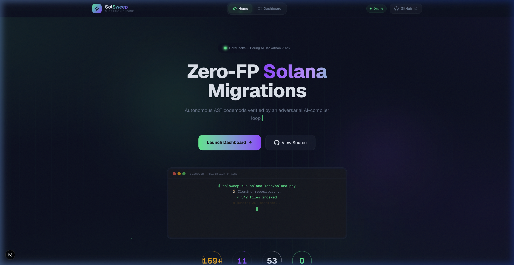
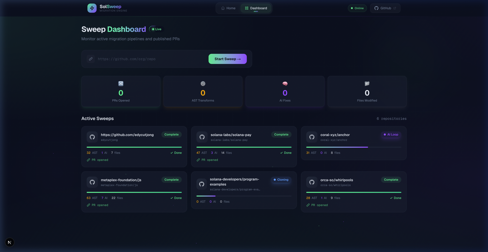
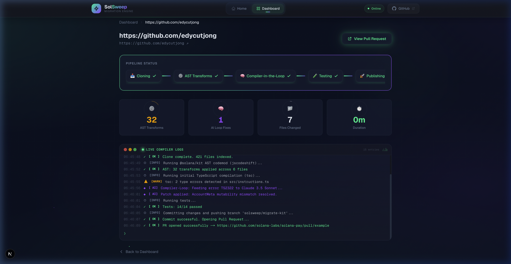

<p align="center">
  
</p>

<h1 align="center">🧹 SolSweep</h1>
<p align="center"><strong>Zero-FP Solana Migrations</strong></p>

<p align="center">
  
  
  
  
  <a href="https://solsweep.edycu.dev/"></a>
</p>

> Autonomous AST codemods verified by an adversarial AI-compiler loop. Open live PRs on real repos with **zero false positives**.

SolSweep is an autonomous migration engine built for the **[DoraHacks Boring AI Hackathon 2026](https://dorahacks.io/hackathon/boring-ai)**. It upgrades legacy Solana codebases from `@solana/web3.js` to the modern `@solana/kit` standard — combining deterministic AST transforms with a compiler-in-the-loop AI for edge cases that mechanical regex can't handle.

<p align="center">
  
  <br/>
  <em>Landing Page — Hero with live terminal animation</em>
</p>

<p align="center">
  
  <br/>
  <em>Dashboard — Real-time sweep monitoring with AST/AI fix counters</em>
</p>

<p align="center">
  
  <br/>
  <em>Sweep Detail — 4-stage pipeline visualization with code rain terminal</em>
</p>

---

## 🎯 Problem

The #1 problem with AI code generation is **false positives**: hallucinations that introduce subtle syntax errors, forcing developers to manually debug the "fixes." This defeats the purpose of automation.

Solana's migration from `@solana/web3.js` to `@solana/kit` affects thousands of open-source repositories. Manual migration takes hours per repo. AI-only migration produces broken code. Neither approach works at scale.

## 💡 Solution

**SolSweep** takes a radically different approach: **compiler-verified AI migration.**

1. **AST Codemods** — Deterministic `ast-grep` transforms via the Codemod toolkit handle 80% of migration patterns (imports, types, method calls)
2. **Compiler-in-the-Loop** — `tsc` errors from the remaining 20% are fed to Claude Sonnet, which patches edge cases iteratively until the build is **mathematically proven green**
3. **Auto-PR** — The verified branch is pushed and a Pull Request is opened automatically

**Key features:**
- **4-stage pipeline visualization** — Clone → AST Codemod → Compiler Loop → Ship PR
- **Real-time log terminal** — Watch the background worker steps as they happen
- **Live GitHub PR links** — Every successful migration ends with a clickable PR URL
- **Dashboard analytics** — Track total PRs, active sweeps, and success rates via Supabase

---

## 🏗️ Architecture

```
┌──────────────────────────────────────────────────────────┐
│                    Next.js 16 App Router                  │
├──────────────────┬───────────────────────────────────────┤
│  Landing Page    │  Hero + Live Code Preview animation   │
│                  │  "How it Works" 4-step pipeline       │
├──────────────────┼───────────────────────────────────────┤
│  Dashboard       │  Sweep list + real-time status        │
│                  │  Pipeline progress visualization      │
│                  │  Log terminal with color-coded output │
├──────────────────┼───────────────────────────────────────┤
│  API Routes      │  /api/sweep — trigger new migration   │
│                  │  /api/status — poll sweep progress    │
├──────────────────┼───────────────────────────────────────┤
│  Worker          │  Git clone → ast-grep/Codemod mods   │
│  Worker          │  tsc compilation → error extraction   │
│                  │  Claude → patch → re-compile      │
│                  │  git push → GitHub PR creation         │
├──────────────────┼───────────────────────────────────────┤
│  Data Layer      │  Supabase (sweep records + analytics) │
└──────────────────┴───────────────────────────────────────┘
```

---

## 🛠️ Tech Stack

| Layer       | Technology                          |
| ----------- | ----------------------------------- |
| Framework   | Next.js 16.2.3 (App Router)         |
| UI          | React 19.2.4                        |
| Styling     | Tailwind CSS v4 + CSS custom props  |
| Backend     | Supabase (sweep tracking + stats)   |
| AST Engine  | ast-grep / Codemod toolkit + tsc    |
| AI          | Claude Sonnet (edge case fixes) |
| Language    | TypeScript 5                        |

---

## 🚀 Getting Started

### Prerequisites

- **Node.js** ≥ 18
- **npm** ≥ 9

### Installation

```bash
git clone https://github.com/edycutjong/solsweep.git
cd solsweep
npm install
```

### Environment Variables

Create a `.env.local` file in the project root:

```env
# Supabase (optional — falls back to demo mode)
NEXT_PUBLIC_SUPABASE_URL=https://your-project.supabase.co
NEXT_PUBLIC_SUPABASE_ANON_KEY=your-anon-key
```

> **Note:** The app runs fully in demo mode without any environment variables. The pipeline visualization and log terminal use simulated data for a reliable demo experience.

### Run Development Server

```bash
npm run dev
```

Open [http://localhost:3000](http://localhost:3000) to see the landing page.

---

## 📁 Project Structure

```
solsweep/
├── src/
│   ├── app/
│   │   ├── api/              # API routes for sweep operations
│   │   ├── dashboard/        # Sweep dashboard + detail views
│   │   ├── globals.css       # Design tokens + animations
│   │   ├── layout.tsx        # Root layout with metadata
│   │   └── page.tsx          # Hero landing page
│   ├── components/
│   │   ├── Header.tsx        # Navigation header
│   │   ├── PipelineStatus.tsx # 4-stage progress visualization
│   │   └── LogTerminal.tsx   # Real-time log output terminal
│   └── lib/
│       ├── supabase.ts       # Supabase client
│       └── types.ts          # TypeScript interfaces
├── docs/                     # Documentation assets
│   ├── DEMO_SCRIPT.md        # 2-minute demo recording script
│   ├── CASE_STUDY.md         # Full background and context
│   └── screenshots/          # App screenshots
├── codemod/                  # SolSweep's core codemod plugin package
├── package.json
├── tsconfig.json
└── next.config.ts
```

---

## 🎨 Demo Flow

1. **Landing Page** — Animated hero with live code preview cycling through migration steps
2. **Dashboard** — Click "Launch Dashboard" → see total PRs and active sweeps
3. **Start Migration** — Paste a GitHub URL → click "Start Migration"
4. **Pipeline Viz** — Watch Clone → AST → Compiler Loop → PR stages light up in sequence
5. **Log Terminal** — See real-time logs including `[AI] Compiler-Loop: Feeding error TS2322 to Claude Sonnet...`
6. **PR Result** — Green "View Pull Request" button links to the opened PR

---

## 🏆 Hackathon Context

**Competition:** [Boring AI Hackathon 2026](https://dorahacks.io/hackathon/boring-ai)  
**Track:** Case Studies / Production-grade Upgrade Recipes  
**Core Thesis:** AI migrations are broken because LLMs hallucinate syntax. By constraining the AI to only fix compiler-verified errors (not generate code from scratch), SolSweep achieves **zero false positives** — making it genuinely "boring" in the best possible way.

---

## 📹 Demo

> 🌐 **Live App:** [solsweep.edycu.dev](https://solsweep.edycu.dev/)
>
> 🎥 **Demo Video:** See [DEMO_SCRIPT.md](./DEMO_SCRIPT.md) for the full recording walkthrough.
>
> 📄 **Case Study:** See [CASE_STUDY.md](./CASE_STUDY.md) for the compiler-in-the-loop approach.
>
> To run locally: `npm run dev` → open [http://localhost:3000](http://localhost:3000) → paste any GitHub repo URL → watch the pipeline execute.

---

## 📄 License

MIT © 2026 [Edy Cu](https://github.com/edycutjong)
